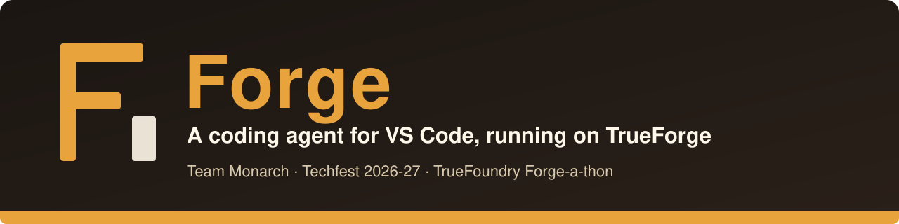
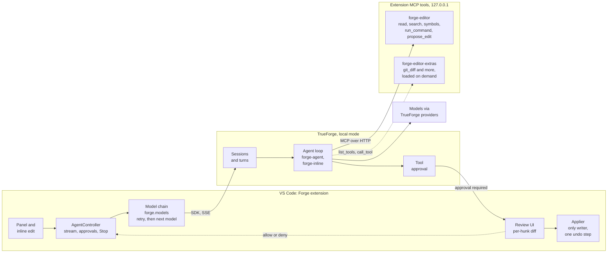
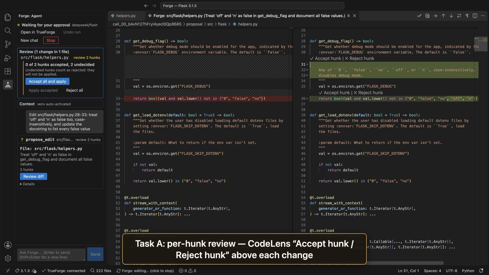
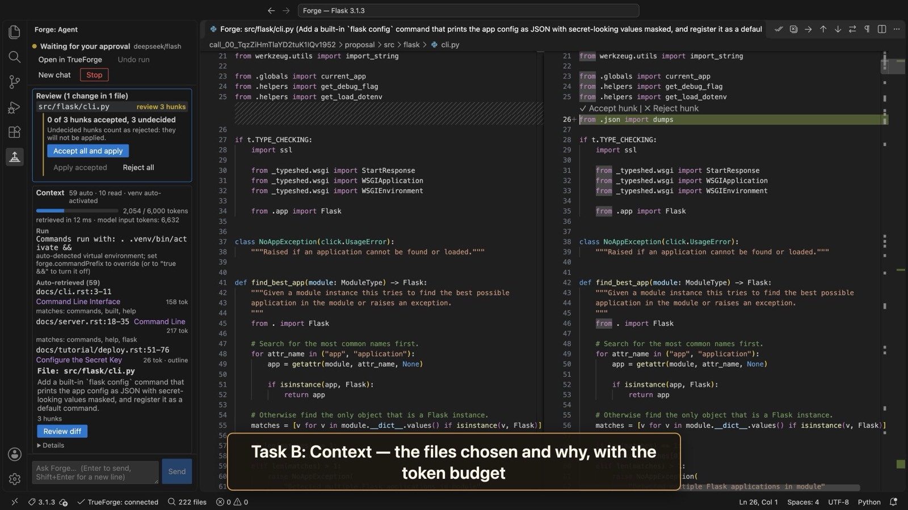
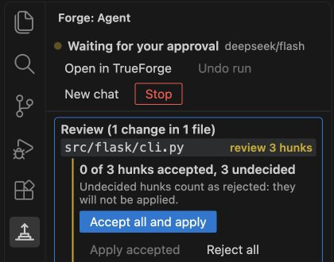
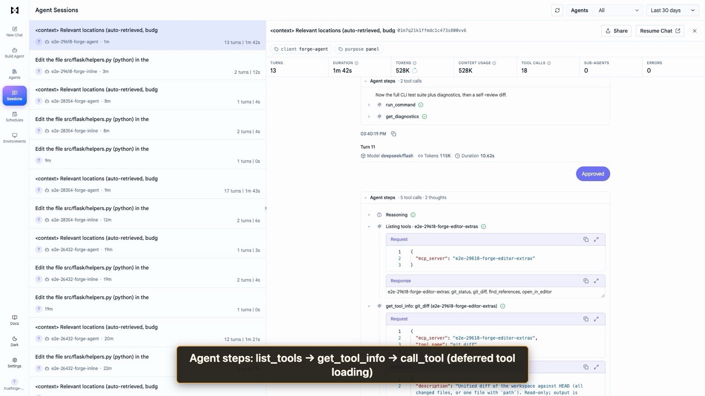

<p align="center">
  
</p>

<p align="center">
  <a href="https://github.com/SrikarNarra16/forge-agent/actions/workflows/ci.yml"></a>
  <a href="LICENSE"></a>
  
  
  <a href="https://trueforge.dev"></a>
</p>

# Forge: a coding agent for VS Code, running on TrueForge

Forge is a VS Code extension. You describe a change (in the **Forge** panel, or by selecting code and pressing `Cmd/Ctrl+Alt+K`); an agent that runs on [TrueForge](https://trueforge.dev) (local mode) reads your project, proposes edits, and **nothing is written to disk until you have reviewed the diff** hunk by hunk.

- **Editor-native review.** Every change is a per-hunk diff in VS Code's own diff editor; nothing is written until you accept, and accepting is ONE undo step (one Cmd+Z).
- **Runs on TrueForge.** The agent loop, sessions and tool approval live in TrueForge, driven through `@truefoundry/trueforge-sdk`; the editor's capabilities are MCP tools served by the extension.
- **Resilient.** Stop is instant and leaves no half-applied edits; if a model provider fails, Forge continues the same request on the next configured model.

<details>
<summary><b>The three points in full</b></summary>

- The extension is only a client of TrueForge: it creates sessions and turns through `@truefoundry/trueforge-sdk` and renders the streamed events. It never calls a model provider itself.
- Editor capabilities (read a file, search, symbols, diagnostics, propose an edit, run a command) are MCP tools that the extension serves on localhost (bearer-token protected) and registers in TrueForge. `propose_edit` / `create_file` are gated by TrueForge's tool approval, which opens the diff review; accepting applies the hunks as ONE undo step.
- Stop is instant and leaves no half-applied edits. If a model provider fails, Forge continues the same request on the next configured model.

</details>

**Starting point:** Built from scratch; no upstream fork. (No code from Cline, Continue, Roo Code, opencode or any other agent was copied; the runtime dependencies are `@truefoundry/trueforge-sdk`, `@modelcontextprotocol/sdk`, `diff`, `ignore` and `zod`.)

## Demo

<!-- video:start -->
**[Watch the demo video (3:30, under the 4-minute limit)](<VIDEO_URL>)**: `<VIDEO_URL>`
<!-- video:end -->

The video is an automated, scripted run of the real extension with captions and no narration: Task A (inline edit, per-hunk review, one-step undo), Task B (agent mode, no files named), Task C (unreachable endpoint, automatic fallback) and Stop. Its plan is in [`docs/recording/shot-list.md`](docs/recording/shot-list.md).

## Contents

- [Quick start (5 lines)](#quick-start-5-lines)
- [How it works](#how-it-works)
- [Rubric at a glance](#rubric-at-a-glance)
- [Screenshots](#screenshots)
- [Prerequisites](#prerequisites)
- [Setup, step by step](#setup-step-by-step): [start TrueForge](#1-start-trueforge-local-mode), models, [agents](#3-agents), [install](#4-install-the-extension)
- [Reference](#reference) (collapsible): settings, model setup and the supported-model matrix, the three fixed tasks, troubleshooting, limitations
- [Development and tests](#development-and-tests)
- [Tech](#tech) · [License](#license)

## Quick start (5 lines)


```bash
git clone https://github.com/SrikarNarra16/forge-agent.git && cd forge-agent
npm ci && npm run build && npm run package               # builds forge-agent-0.0.1.vsix
npm run tf:start                                          # terminal 1: TrueForge on http://localhost:8790 (leave it running)
export DEEPSEEK_API_KEY=<your key> && npm run tf:setup    # terminal 2: registers the model providers
scripts/setup-fixture.sh && code --install-extension forge-agent-0.0.1.vsix && code ../fixtures/flask   # Flask 3.1.3 + the extension
```

Then open the **Forge** view in the activity bar: the status bar should say `TrueForge: connected`. Try it without a model first: Command Palette -> **Forge: Fake Proposal** shows the whole review UI (diff, per-hunk Accept/Reject, Apply) on a made-up change; **Reject all** discards it. With a model: type a request in the panel.

## How it works



The extension is only a client of TrueForge; every model call goes through it. The text version of this diagram and the rules the code enforces:

<details>
<summary><b>Architecture (text diagram) and enforced rules</b></summary>


```text
 VS Code window                                                     your machine, localhost
┌───────────────────────────────────────────────────────────────┐
│ Forge extension (TypeScript)                                  │
│                                                               │   ┌──────────────────────────────┐
│  Agent panel (webview) ─┐                                     │   │ TrueForge (local mode)       │   ┌────────────────┐
│  Inline edit  ──────────┼─► AgentController ─ model chain ────┼──►│  agent loop, sessions, SSE   │──►│ model provider │
│  Review UI (diff,       │      (stream, approvals, Stop)      │   │  `forge-agent`, `forge-inline`│   │ (DeepSeek, …)  │
│  CodeLens, panel card) ◄┘            ▲                        │   └──────────────┬───────────────┘   └────────────────┘
│            │ accepted hunks          │ allow / deny           │                  │ MCP over HTTP (bearer token)
│            ▼                         │                        │                  ▼
│  Applier (the ONLY writer) ◄─ ReviewApprovalHandler           │   tool calls: read_file, search_code, get_symbols,
│  one WorkspaceEdit = one undo step                            │   get_diagnostics, run_command, propose_edit, create_file…
│                                                               │                  │
│  MCP server (127.0.0.1) ◄─────────────────────────────────────┼──────────────────┘
└───────────────────────────────────────────────────────────────┘
```

Rules the code enforces and tests check: no model provider is ever called from the extension; only `src/review/applier.ts` writes files (`test/writeIsolation.test.ts`); `propose_edit`/`create_file` need your per-hunk review; the edit tools only report decisions; cancellation leaves no partial edit; nothing blocks the extension host.

</details>

## Rubric at a glance

| Criterion | What it does | Where |
|---|---|---|
| **A1** Inline edit | Select code, `Cmd/Ctrl+Alt+K`, type an instruction: a diff opens with per-hunk Accept / Reject | `src/inline/`, `src/review/codeLens.ts` |
| **A2** Agent mode | Panel request with no files named; the agent finds and edits several files (Task B: `cli.py`, `tests/test_cli.py`, `docs/cli.rst`) | `src/ui/panel.ts`, `src/ui/webview/`, `agents/forge-agent.json` |
| **A3** Streaming and cancel | Streamed events in the panel; Stop = `sessions.cancel`, pending reviews closed, the run rolled back | `src/trueforge/agentController.ts`, `src/review/checkpoints.ts` |
| **B1** Context assembly | Local BM25 index plus @mentions under a token budget; the panel's Context section shows each item with its reason | `src/context/`, `src/ui/webview/contextView.ts` |
| **B2** Diff safety | Per-hunk review before anything is written; accepted hunks applied as ONE `WorkspaceEdit` (one Cmd+Z); only one module can write | `src/review/applier.ts`, `src/review/reviewHandler.ts`, `test/writeIsolation.test.ts` |
| **B3** Resilience | Retry twice (0.5 s, 1.5 s), then the same request on the next model in `forge.models` in a new session; the workspace stays untouched | `src/trueforge/modelChain.ts`, `src/trueforge/agentController.ts` |
| **B4** TrueForge depth | MCP tools, per-tool approval driving the diff review, deferred tool loading (`list_tools` / `get_tool_info` / `call_tool`); subagents and compaction are configured but were not triggered in our runs | `src/mcp/`, `src/trueforge/`, `agents/*.json` |

Where each claim is evidenced (tests, run records, video timestamps): [`docs/walkthrough.md`](docs/walkthrough.md), [`Forge-writeup.pdf`](Forge-writeup.pdf).

## Screenshots

Frames from the automated take (captions are part of the video).

| | |
|---|---|
|  |  |
| **Per-hunk review.** Task A: the CodeLens above each change, and the card with Accept all and apply / Apply accepted / Reject all. | **Context section.** Task B: auto-retrieved items with reasons (`matches: ...`) and the 6,000-token budget bar. |
|  |  |
| **Review card.** Undecided hunks count as rejected; Apply writes only what you accepted. | **TrueForge Sessions page.** Approval pauses and the deferred tool loading steps of the same run. |

## Prerequisites


| What | Version | Used for |
|---|---|---|
| Node.js + npm | **>= 22.14** (tested with 26.0) | TrueForge requires it; also builds the extension |
| VS Code | **>= 1.95** (tested with 1.143) | the `code` command must be on your PATH for the commands above (VS Code: Command Palette -> "Shell Command: Install 'code' command in PATH") |
| git | any recent | cloning Forge and the Flask fixture |
| Python | **>= 3.9** with `venv` (tested with 3.9.6) | only for the Flask tasks: `scripts/setup-fixture.sh` makes a virtualenv with Flask 3.1.3 and pytest |
| A model API key | DeepSeek (default models) and/or Groq | `DEEPSEEK_API_KEY`, optional `GROQ_API_KEY`. Keys are read from environment variables only, never from files in the repo |

## Setup, step by step

### 1. Start TrueForge (local mode)


```bash
npm run tf:start
```

This runs `npx @truefoundry/trueforge@0.183.1` (the version everything here was tested with; `TRUEFORGE_VERSION=latest npm run tf:start` tries another; UI + API on http://localhost:8790, SQLite, no Redis) with the environment variables Forge needs, see `trueforge/start.sh`:

| Variable | Value | Why |
|---|---|---|
| `OUTBOUND_URL_ALLOWED_HOSTS` | `["localhost","127.0.0.1"]` | **Required.** TrueForge's SSRF guard blocks loopback URLs by default, which would block the extension's MCP server |
| `MODEL_HTTP_CONNECT_TIMEOUT_MS` | `3000` | an unreachable model endpoint fails in about 3 s, so the fallback is quick |
| `MODEL_HTTP_MAX_RETRIES` | `1` | Forge retries and falls back itself |

Extra arguments are passed through (`npm run tf:start -- --port 8791`). Other useful TrueForge variables: `PORT`, and `SQLITE_PATH` for a separate database.

### 2. Configure models

Providers, keys and switching models are in [Reference](#reference) ("Model setup"), the supported-model matrix right after it. The quick start above already registers the DeepSeek providers.

### 3. Agents


The agent definitions are in the repo: `agents/forge-agent.json` (the panel agent) and `agents/forge-inline.json` (the inline edit). You do not register them by hand: when the extension activates it registers its MCP server in TrueForge (`forge-editor`, `forge-editor-extras`) and saves both agents (names `forge-agent`, `forge-inline`; `forge.resourcePrefix` adds a prefix so two windows or test runs never collide). `npm run tf:setup` also saves them once the MCP server exists. Edit the JSON and reload the window to change instructions or tool lists.

### 4. Install the extension


- **From the repo (development):** open this folder in VS Code and press `F5` ("Run Extension").
- **From a package:** `npm run package` creates `forge-agent-0.0.1.vsix`; `code --install-extension forge-agent-0.0.1.vsix`. To try it without touching your own profile: `code --user-data-dir /tmp/forge-profile --extensions-dir /tmp/forge-ext --install-extension forge-agent-0.0.1.vsix`, then start VS Code with the same two flags.

## Reference

<details>
<summary><b>Settings and commands</b></summary>


| Setting | Default | What it does |
|---|---|---|
| `forge.trueforge.baseUrl` | `http://localhost:8790` | Base URL of the local TrueForge server |
| `forge.models` | `["deepseek/flash", "deepseek/v4-pro"]` | Ordered TrueForge models. The first is used; if its provider fails (unreachable, bad key, overloaded, stalled) Forge retries with backoff, then continues on the next one in a new TrueForge session. **Forge: Switch Model** changes the first |
| `forge.contextBudgetTokens` | `6000` | Token budget for automatically injected context |
| `forge.commandPrefix` | empty = auto | Shell prefix before every agent command. Empty: if the workspace has `.venv/bin/activate` (else `venv/bin/activate`), `. .venv/bin/activate &&` is used (POSIX `.`, works in dash, bash, zsh). Your value always wins; `true &&` turns it off. The effective prefix is shown in the panel's Context section. Windows layouts (`Scripts\activate`) are not detected |
| `forge.autoAllowCommands.readOnly` | **off** | Tier 1: run `git status/diff/log/show/ls-files`, `ls`, `pwd`, `cat`, `head`, `tail`, `wc`, `grep` (no `-r`), `rg` on workspace paths without asking |
| `forge.autoAllowCommands.tests` | **off** | Tier 2: run `pytest`, `ruff check` (never `--fix`), `mypy` without asking. **Risk: these execute workspace code** (pytest imports and runs your tests and `conftest.py`) |
| `forge.rollbackOnCancel` | `true` | Stop rolls back the edits applied during the cancelled run |
| `forge.stallFirstEventSeconds` / `forge.stallIdleSeconds` | `45` / `90` | A model silent for that long counts as stalled (retry, then next model); time waiting for your approval or a tool never counts |
| `forge.resourcePrefix` | empty | Prefix for the TrueForge resources Forge registers; reload the window after changing it. The environment variable `FORGE_RESOURCE_PREFIX` wins |

Auto-allow details (what exactly matches, what always asks): `docs/approval-friction.md`. The strict rule: the WHOLE command must match, so anything with `&&`, `;`, `|`, redirects, `$( )`, backticks, `sudo`, `rm`, write flags (`--fix`, `-o`, `--junitxml`...), an unknown option, a path outside the workspace or a secrets file still shows the normal Allow card.

Commands: **Forge: Open Agent**, **Edit Selection…** (`Cmd/Ctrl+Alt+K`), **Stop**, **Undo Last Agent Run**, **Switch Model**, **Rebuild Context Index**, **Accept/Reject Hunk(s)**, **Apply Accepted Hunks** (`Cmd/Ctrl+Enter`), **Fake Proposal** (try the review without a model).

</details>

<details>
<summary><b>Model setup (providers, keys, switching)</b></summary>


`trueforge/models.example.json` lists the providers (DeepSeek `flash` and `v4-pro`, Groq `gpt-oss-120b`, plus two demo-only broken ones for Task C). **API keys are never stored in it**: `apiKeyEnv` names the environment variable that holds the key.

```bash
export DEEPSEEK_API_KEY=...        # GROQ_API_KEY=... is optional
npm run tf:setup                   # idempotent: creates or replaces the providers
```

A provider whose key variable is not set is skipped with a message. To change providers or models, copy the file to `trueforge/models.local.json` (gitignored) and edit it; `tf:setup` prefers it. The model names Forge uses are `provider/model`, e.g. `deepseek/flash` (setting `forge.models`, or **Forge: Switch Model**).

</details>

<details>
<summary><b>Which models work (supported / unsupported matrix)</b></summary>

The organisers may pick the model, so Task A was run headlessly once per model registered in TrueForge, twice over (details, failure texts and timings: [`docs/model-matrix.md`](docs/model-matrix.md)):

| Status | Models |
|---|---|
| **Supported** (passed both passes) | `deepseek/flash` (default), `deepseek/v4-pro`, `google-gemini/gemini-3-1-flash-lite`, `google-gemini/gemini-3-5-flash-lite`, `google-gemini/gemini-flash-lite-latest` |
| Works but slow / intermittent (provider overload) | `google-gemini/gemma-4-26b-a4b-it`, `google-gemini/gemma-4-31b-it` (passed in one pass after 2.5 min, 503 in the other) |
| Not usable at the time of testing | `google-gemini/gemini-3-5-flash`, `-3-6-flash`, `-3-7-flash`, `-3-8-flash`, `gemini-flash-latest` (provider 503 "high demand"); `google-gemini/gemini-3-1-pro-preview` (429: free-tier quota 0 for this key) |
| **Unsupported** | `groq/gpt-oss-120b`: TrueForge replays the assistant message with `reasoning_content` and Groq answers HTTP 400 (`'messages.2' ... property 'reasoning_content' is unsupported`) |

A failing model shows its provider message in the panel (the model is named); the workspace is untouched, and with a second model in `forge.models` the run continues there. Switch models with **Forge: Switch Model** or the `forge.models` setting (first entry is used). Task B was evaluated on the DeepSeek models only (`docs/eval-results.md`).

</details>

<details>
<summary><b>The three fixed tasks (Flask 3.1.3) and their verify scripts</b></summary>


```bash
scripts/setup-fixture.sh        # clones Flask at commit 22d92470 into ../fixtures/flask, creates its .venv (idempotent)
code ../fixtures/flask          # open it with the extension installed
scripts/reset-fixture.sh        # between tasks: discards changes in the fixture (never touches .venv)
```

| Task | What you do | Verify |
|---|---|---|
| **A** | Open `src/flask/helpers.py`, select `get_debug_flag`, press `Cmd/Ctrl+Alt+K`, type: *treat 'off' and 'n' as false too, case-insensitively, and update the docstring to list every false value*. Review the diff, accept, apply (`Cmd/Ctrl+Enter`) | `scripts/verify-task-a.sh`, or by hand `FLASK_DEBUG=off ../fixtures/flask/.venv/bin/python -c "import flask.helpers as h; print(h.get_debug_flag())"` prints `False` |
| **B** | In the Forge panel, no files named: *Add a built-in CLI command `flask config` that prints the app config as JSON, masking the value of any key containing SECRET, PASSWORD, TOKEN, or KEY as "\*\*\*". It must appear in `flask --help`, have a test, and be documented with the other built-in commands.* Allow its commands, review each diff, apply | `scripts/verify-task-b.sh` (scores 7 checks) and `../fixtures/flask/.venv/bin/python -m pytest ../fixtures/flask/tests/test_cli.py -q` |
| **C** | Break the model first: `npm run tf:setup -- --only-demo` (registers two demo providers that need no key), set `forge.models` to `["broken-endpoint/broken", "deepseek/flash"]`, repeat Task A. The editor stays responsive; Forge says the first model is unreachable and continues on `deepseek/flash` (to see the clear error instead, use only `["broken-endpoint/broken"]`) | `git -C ../fixtures/flask status` is clean before you apply anything; then `scripts/verify-task-a.sh` |

`FIXTURE_DIR=/path/to/flask` overrides the fixture location for the scripts. More detail: `docs/task-c-demo.md`, `docs/cancel-tests.md`.

</details>

<details>
<summary><b>Troubleshooting</b></summary>


| Symptom | What to do |
|---|---|
| TrueForge's web page (Sessions) is blank but the extension works | TrueForge's files were replaced while it ran (a newer `npx` version). Stop it and start it again with `npm run tf:start` (pinned to the tested version; data is kept) |
| Status bar says `TrueForge: disconnected` | TrueForge is not running or `forge.trueforge.baseUrl` is wrong. Start it with `npm run tf:start` |
| **Port 8790 is in use** (another TrueForge, or something else) | Reuse the running TrueForge, or start a second one on another port with its own database: `SQLITE_PATH=/tmp/tf.sqlite npm run tf:start -- --port 8791`, then `npm run tf:setup -- --base-url http://localhost:8791` and set `forge.trueforge.baseUrl` to `http://localhost:8791` |
| The agent cannot use its tools / "MCP server" errors | TrueForge was started without `OUTBOUND_URL_ALLOWED_HOSTS` (use `npm run tf:start`, not a plain `npx`), or Node is older than 22.14 |
| **Provider 503 / overloaded / timeouts** | Forge retries (0.5 s, 1.5 s), then continues on the next model in `forge.models` and says so in the panel. If every model fails you get one clear message naming each model and its failure; the workspace is untouched. Check the provider's status page, or add a second provider/model |
| **Key invalid** (401, "API key not valid") | The first model is skipped with a message naming it. Re-export the key and run `npm run tf:setup` again (it replaces the provider) |
| `tf:setup` says "Skipping provider ... environment variable is not set" | Export the variable named in the message, or ignore it if you do not use that provider |
| "No provider can be registered" | No key variable is set at all: `export DEEPSEEK_API_KEY=...` |
| `scripts/verify-task-*.sh` says the fixture is missing | Run `scripts/setup-fixture.sh` (needs git and Python >= 3.9) |
| Review diff shows no Accept/Reject buttons | Needs the setting `diffEditor.codeLens` (Forge enables it by default; Forge asks once if you turned it off). Fallbacks: **Forge: Review Hunks…**, the panel's buttons, `Cmd/Ctrl+Enter` |
| Accept/Reject lenses are tiny when screen-recording | VS Code setting `editor.codeLensFontSize` (e.g. 15) |
| Where are the logs? | Output panel -> **Forge**: every tool call with its reason, the TrueForge session id and URL; **Open in TrueForge** (panel header) opens the session |

</details>

<details>
<summary><b>Limitations</b></summary>


- Local TrueForge only (SQLite standalone mode); no remote or multi-user setup, no authentication to TrueForge beyond what local mode has.
- `run_command` uses a POSIX shell (`$SHELL -c`): macOS and Linux. Windows is not supported for commands, and the venv prefix auto-detection does not look for `Scripts\activate`.
- Tested with VS Code 1.143 on macOS (arm64), Node 26, Python 3.9. Other platforms are untested.
- Review diffs use VS Code CodeLens in the diff editor; a very large file (over the review size limit) is refused instead of blocking the editor.
- The model decides what to change: quality depends on the model. Task B results vary from run to run (see `docs/eval-results.md` for measured pass rates).
- Auto-allow cannot see through symlinks inside the workspace that point outside it.
- Model-fallback keeps the request but not the earlier turns of the conversation (a new TrueForge session is used, and the panel says so).

</details>

## Development and tests


```bash
npm run build && npm run typecheck && npm run lint && npm test     # what CI runs (no VS Code needed)
npm run test:e2e         # real VS Code, hermetic scenarios (needs VS Code; set VSCODE_EXE for another install)
npm run test:ui:panel    # Playwright clicks on the panel's review card (no model)
# install check of the packaged .vsix, against a SEPARATE TrueForge (it registers forge-agent & co. under their real names):
#   SQLITE_PATH=/tmp/tf.sqlite npm run tf:start -- --port 8791     # terminal 1
#   export DEEPSEEK_API_KEY=... && npm run tf:setup -- --base-url http://localhost:8791   # models first: agents need them
#   TRUEFORGE_BASE_URL=http://localhost:8791 npm run test:vsix -- forge-agent-0.0.1.vsix
```

Submission kit: `docs/SUBMISSION.md` (links to paste and the few manual steps), `Forge-writeup.pdf` (rendered from `docs/writeup/WRITEUP.md` by `npm run writeup:pdf`; `npm run writeup:set-url -- <video URL>` fills in the video link and re-checks it; needs Google Chrome), `docs/walkthrough.md` (architecture per rubric item, how to repeat Task A with another model, likely questions), `docs/model-matrix.md`, and the video: `npm run video:take` drives the real extension in a real VS Code (Playwright), captures captioned frames and encodes an H.264 MP4 with a small Swift tool (macOS only, no ffmpeg); the plan is in `docs/recording/shot-list.md`. The older human-recording kit (`docs/recording/preflight.sh`, `reset.sh`, `recording-notes.md`) is kept as a fallback.

`docs/e2e.md` explains the end-to-end layers, their isolation (temp profile, throwaway `e2e-<pid>-` TrueForge resources, your own resources are never touched) and known risks; `docs/eval-results.md` has the evaluation of Tasks A and B; `docs/approval-friction.md` the approval measurements.

Built with the help of AI coding tools (Claude Code); see `docs/writeup/WRITEUP.md` for what was used.

## Tech

TypeScript (VS Code extension host and a webview), esbuild, vitest; `@truefoundry/trueforge-sdk` and `@modelcontextprotocol/sdk`, `diff`, `ignore`, `zod` at runtime; Playwright and `@vscode/test-electron` for the end-to-end tests. The agent loop runs in TrueForge, not in the extension.

## License


MIT, see `LICENSE`.

---

<p align="center">Team Monarch · Techfest 2026-27 · <a href="https://trueforge.dev">TrueForge</a> · <a href="https://techfest.org">Techfest, IIT Bombay</a> · TrueFoundry Forge-a-thon</p>
